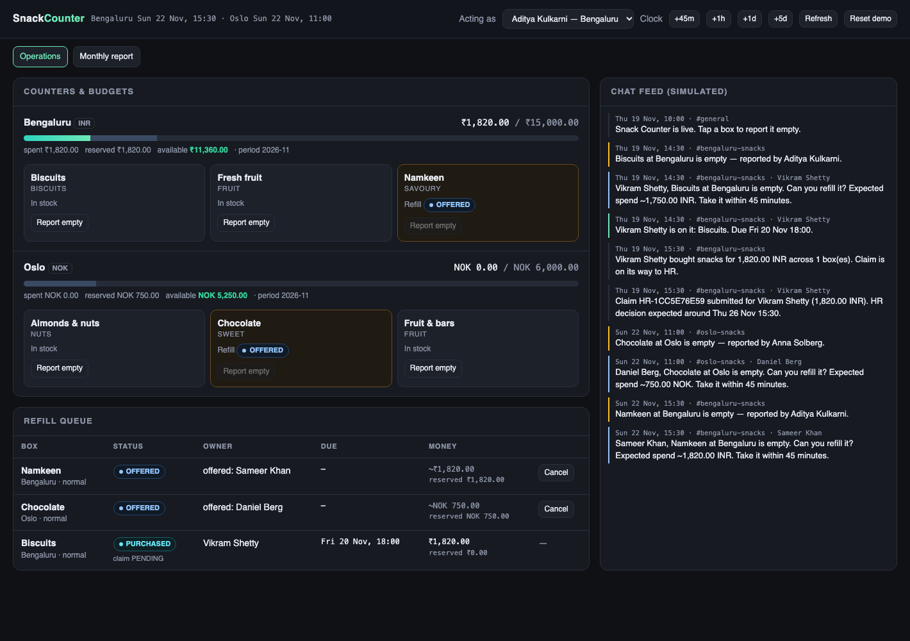

# Snack Counter

Automates the empty-box → someone-buys → reimbursed loop for the Oslo and Bengaluru snack
counters, with a simulated chat tool and a simulated HR system.

* **Design document:** [`docs/DESIGN.md`](docs/DESIGN.md)
* **Core logic:** `src/snackcounter/`
* **Tests:** `tests/` (49 tests, including real two-thread races on SQLite)
* **Dashboard:** served at `/` by the API



## Quick start

```bash
cd snack-counter
python3 -m venv .venv
.venv/bin/pip install -r requirements.txt

# 1. Replay a scripted week and print the monthly report
.venv/bin/python -m snackcounter demo

# 2. Automated tests
.venv/bin/python -m pytest

# 3. Live dashboard + API (seeded offices/boxes, simulated clock you can advance)
.venv/bin/python -m snackcounter serve --port 8000 --reset --demo-clock
# open http://127.0.0.1:8000

# Without --demo-clock the server uses the real clock; the advance-clock buttons then
# do nothing and HR decisions happen on their own schedule.


# 4. Report from a running server's database
.venv/bin/python -m snackcounter report --db snackcounter.db --period 2026-11
```

If you prefer not to install the package: `PYTHONPATH=src .venv/bin/python -m pytest`.

## What is where

| File | Contents |
|---|---|
| `src/snackcounter/service.py` | lifecycle, conditional updates, assignment, purchases, sweeper |
| `src/snackcounter/policy.py` | eligibility and fairness ranking |
| `src/snackcounter/money.py` | integer minor units, explicit-rate conversion, receipt allocation |
| `src/snackcounter/report.py` | per-office/per-currency monthly report + grand total |
| `src/snackcounter/hr.py` | `HrPort` + `FakeHr` (1–10 day decisions, idempotent claims, payroll currency) |
| `src/snackcounter/chat.py` | `ChatPort` + `FakeChat` transcript |
| `src/snackcounter/db.py` | schema, partial unique index, `BEGIN IMMEDIATE` transactions |
| `src/snackcounter/api.py` | FastAPI endpoints + dashboard serving |
| `src/snackcounter/static/index.html` | single-page dashboard, no build step |
| `src/snackcounter/cli.py` | `demo`, `serve` (incl. `--demo-clock`), `report` |

## The three rules the exercise asks to prove

1. **Two people cannot commit to one refill.** `service.accept()` is a conditional
   `UPDATE … WHERE version=? AND status IN ('OFFERED','BROADCAST')`; a partial unique index
   `one_active_refill_per_box` is the database-level backstop. Proven by
   `tests/test_concurrency.py` with two real threads and two SQLite connections.
2. **An abandoned refill is handed to someone else.** The sweeper reminds once at the
   deadline, then after a 4-hour grace window reopens the refill, excludes the previous
   owner, increments their abandonment count and offers it to the next candidate. Proven by
   `test_uncompleted_refill_is_reminded_then_handed_over` and
   `test_expired_offer_is_reassigned_and_the_sweep_is_idempotent`.
3. **Budgets and totals are right across both currencies.** Spend is stored in the office
   currency with the receipt currency, converted amount and FX rate on every line; the
   report emits NOK and INR subtotals and a single grand total at a persisted month-end
   rate. Proven by `tests/test_report.py` and `tests/test_budget.py`.

## Ten-minute walkthrough

1. `demo` — follow the numbered sections: report → offer → accept → second accept rejected →
   purchase → multi-box receipt → decline ladder → reminder → hand-over → HR approvals →
   report. The transcript is the simulated chat; the trailing table is final state.
2. Show `service.accept()` and `_transition()` (`src/snackcounter/service.py`): point at the
   conditional `UPDATE` and the row-count check, then `db.py` for the partial unique index.
3. Run `pytest tests/test_concurrency.py -v` to show two threads racing for real.
4. Open the dashboard: report a box empty, switch "Acting as" to the offered person, accept,
   log a receipt, advance the clock, then open **Monthly report**.
5. Close on trade-offs: no payments, no queue, no IoT — and the exact limits in
   `docs/DESIGN.md` §5.

## Deliberate limitations

Single-process SQLite (right for ~35 volunteers); presence is declared rather than inferred;
there is no real chat/HR client, only the ports and fakes; over-budget refills need a manager
override; a box purchased within six hours cannot be reported empty again.
